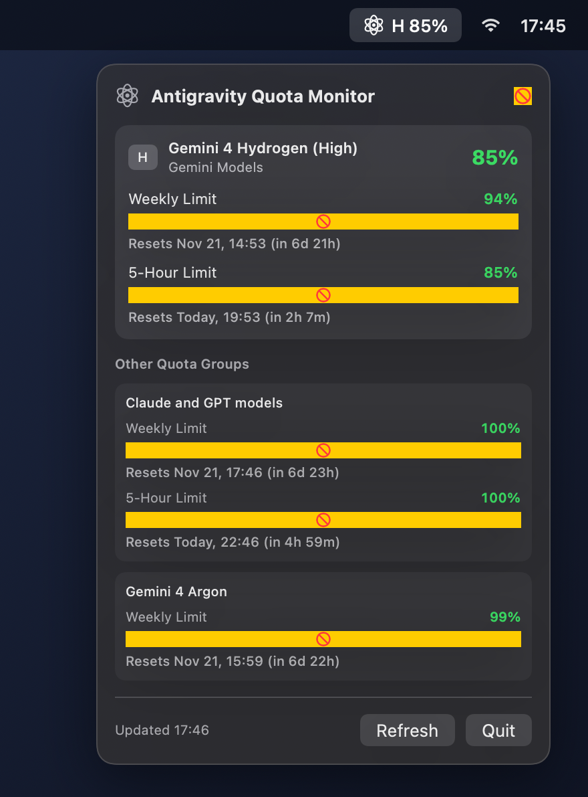

# Antigravity Quota Monitor

A lightweight native macOS menu bar utility written in Swift and SwiftUI that monitors the remaining usage quota for the Google Antigravity AI model currently selected in Xcode.

> **Status:** All milestones (0–7) are complete (`v1.0`). Built with native SwiftUI, Apple Accessibility APIs, and the official Antigravity CLI (`agy`).

## Overview

Antigravity Quota Monitor lives unobtrusively in the macOS menu bar (`LSUIElement`), detects which Antigravity AI model is selected in Xcode's built-in assistant, queries real quota data through the official Antigravity CLI (`agy`), and surfaces the most restrictive remaining quota percentage at a glance (for example, `H 90%` or `A 99%`).

## Features

- Native macOS SwiftUI `MenuBarExtra` menu bar item displaying the orbital icon (`atom`) alongside the active model's abbreviation and lowest remaining percentage (e.g., `H 90%`, `A 99%`)
- Menu bar agent configuration (`LSUIElement = YES`) with no Dock icon or standalone window
- Expanded SwiftUI popover showing:
  - Active Xcode model label, matched quota group, and color-coded limiting percentage
  - 5-hour and weekly quota progress bars with local-timezone reset timestamps and relative countdowns
  - Other available quota groups (`Claude and GPT models`, `Gemini 4 Argon`, etc.)
  - Explicit states for missing Accessibility permission (with prompt button), Xcode not running, unmatched models, stale snapshots, and CLI errors
  - Last updated timestamp, manual `Refresh` (`Cmd + R`), inline `Settings`, and `Quit` (`Cmd + Q`)
- Background polling & lightweight active-model tracking:
  - Configurable periodic quota refresh timer (2, 3, 4, or 5 minutes; default 3 minutes)
  - Periodic lightweight Xcode model check (every 15 seconds) plus immediate sync on popover open
  - Stale threshold tracking and last-valid snapshot preservation on transient CLI errors
  - In-flight CLI task coalescing so overlapping `agy` subprocesses never spawn
- Native inline Settings (`SettingsView` + `PreferencesStore`):
  - Refresh interval picker (2–5 min) persisted in `UserDefaults`
  - Optional custom `agy` CLI executable path persisted in `UserDefaults`
  - Optional Launch at Login toggle using Apple's `ServiceManagement` (`SMAppService.mainApp`)
  - Live Accessibility permission status indicator
- Tested modular architecture (`35` unit tests across `9` Swift Testing suites + UI launch/relaunch verification)

## Screenshots

| Menu Bar Indicator & Quota Popover | Inline Settings |
|---|---|
|  |  |

## System Requirements

- macOS 15.0 or later (verified on macOS 26.7.2, Apple Silicon)
- Xcode 16+ / Xcode 27.2+ (for building from source)
- macOS Accessibility permission granted to `AntigravityQuotaMonitor` (required for active model detection)
- Antigravity CLI (`agy`) installed locally and authenticated (verified on `1.5.9`)

## Installation

### Option 1: Build and Run from Xcode

1. Clone the repository:
   ```bash
   git clone https://github.com/GorkemSay/antigravity-quota-monitor.git
   cd antigravity-quota-monitor
   ```
2. Open `AntigravityQuotaMonitor.xcodeproj` in Xcode.
3. Select the **AntigravityQuotaMonitor** scheme and **My Mac** run destination.
4. Build and run (`Cmd + R`).
5. When prompted (or via **System Settings > Privacy & Security > Accessibility**), grant Accessibility permission to **AntigravityQuotaMonitor**.

### Option 2: Local Release Build (`xcodebuild`)

```bash
xcodebuild build \
  -project "AntigravityQuotaMonitor.xcodeproj" \
  -scheme "AntigravityQuotaMonitor" \
  -configuration Release \
  -destination "platform=macOS" \
  -derivedDataPath build/ReleaseDerivedData
```

The signed application bundle is created at:

```text
build/ReleaseDerivedData/Build/Products/Release/AntigravityQuotaMonitor.app
```

You can copy `AntigravityQuotaMonitor.app` to `/Applications` and launch it directly.

## Permissions and Privacy

- **Accessibility Permission:** Required strictly to inspect the selected model label in Xcode's model picker control (`AXMenuButton`). The application does not collect source code, conversation history, or unrelated application data.
- **No App Sandbox (Local Execution):** App Sandbox is disabled on the macOS target so the app can query Accessibility attributes from Xcode and invoke the user-installed `agy` CLI executable via `Process`.
- **Credentials & Logging:** The application does not read, store, or extract OAuth tokens or authentication credentials, makes no direct network calls, and does not log raw CLI output by default.

## Antigravity CLI Requirements

The application invokes the locally installed Antigravity CLI (`agy`, verified on `1.5.9` at `~/.local/bin/agy`) using:

```bash
agy -p "/usage" --output-format json
```

Because macOS GUI applications launched from Finder or Xcode do not inherit interactive terminal `PATH` variables, `AntigravityQuotaProvider` checks `$HOME/.local/bin/agy`, `/opt/homebrew/bin/agy`, `/usr/local/bin/agy`, `/usr/bin/agy`, `PATH` entries, and any custom path configured in Settings.

## How It Works (Architecture Overview)

1. **Xcode Model Detection (`XcodeModelDetector`):** Locates running Xcode processes via `NSRunningApplication`, inspects focused, main, and secondary Xcode windows using Apple's Accessibility APIs (`AXUIElement`), and parses the model picker's accessibility label into `DetectedModel`.
2. **Quota Retrieval (`AntigravityQuotaProvider`):** Executes `agy -p "/usage" --output-format json` in a non-blocking subprocess with timeout, file-handle cleanup, and overlap protection, extracts balanced JSON safely, and decodes `QuotaSnapshot`, `QuotaGroup`, and `QuotaBucket` models.
3. **Matching, Polling & Presentation (`ModelQuotaMapper`, `QuotaManager`, `PreferencesStore`):** Maps the active model to its quota group, refreshes quotas periodically in the background, preserves stale snapshots clearly if a refresh fails, and presents everything in SwiftUI `MenuBarExtra`.

## Supported Model Groups (Observed CLI Configuration)

Based on observed CLI output on macOS (subject to account configuration and future CLI updates):

| Model | Quota Group | Observed Buckets |
|---|---|---|
| Gemini 4 Hydrogen | Gemini Models | Weekly, 5-hour |
| Gemini 3.8 Flash | Gemini Models | Weekly, 5-hour |
| Gemini 4 Argon | Gemini 4 Argon | Weekly |
| Claude Opus 5.5 | Claude and GPT models | Weekly, 5-hour |
| Claude Sonnet 5.5 | Claude and GPT models | Weekly, 5-hour |
| GPT-OSS 120B | Claude and GPT models | Weekly, 5-hour |

## Why This Approach?

### Built on Official Tools

Antigravity Quota Monitor retrieves usage information through Google's Antigravity CLI using its supported command-line interface.

Rather than depending on undocumented internal server endpoints, private authentication mechanisms, or intercepted application traffic, the application uses an existing CLI command to request structured usage information.

This reduces dependency on Antigravity's internal implementation details.

### Native Xcode Model Detection

The application identifies the currently selected Antigravity model using Apple's Accessibility APIs.

It reads the model selection information exposed by Xcode's user interface without modifying Xcode, replacing its built-in agent, or intercepting AI conversations.

This enables automatic model-aware quota monitoring while preserving the user's existing development workflow.

### Privacy by Design

The application operates locally on macOS.

It does not independently collect authentication tokens, read conversation contents, or transmit usage information to application-operated third-party servers.

Quota requests are performed through the installed Antigravity CLI, which may communicate with Google's services as part of its normal operation.

The application requests Accessibility permission only to obtain the model information required for its functionality.

### Reliability Through Separation of Concerns

Model detection, quota retrieval, data parsing, quota mapping, and user interface presentation are structured as independent components.

This architecture makes the application easier to test, maintain, and adapt when Antigravity or Xcode changes.

It also supports explicit error handling, controlled refresh intervals, and safeguards against displaying incorrect or outdated quota information.

### Transparent Limitations

Reliability does not mean guaranteed compatibility with every future version.

The application depends on the continued availability and compatibility of the Antigravity CLI usage command and Xcode's accessibility information.

CLI output formats, model names, quota groups, and Xcode accessibility hierarchies may change.

The application is designed to handle these changes gracefully and clearly communicate when information cannot be retrieved or verified.

### Engineering Principles

Our approach prioritizes:

- Officially provided tools and supported Apple APIs wherever possible.
- Minimal interference with Xcode and Antigravity.
- No direct handling of authentication credentials.
- Modular, testable Swift components.
- Accurate quota reporting with clearly indicated refresh times.
- Explicit error states instead of misleading fallback values.
- Low system resource consumption.
- Long-term maintainability.

> *Note: Antigravity Quota Monitor is an independent utility and is not endorsed by, certified by, or affiliated with Google or Apple.*

## Development Instructions

### Running Tests

Using Xcode, select the **AntigravityQuotaMonitor** scheme and press `Cmd + U`, or run via `xcodebuild`:

```bash
xcodebuild test \
  -project "AntigravityQuotaMonitor.xcodeproj" \
  -scheme "AntigravityQuotaMonitor" \
  -destination "platform=macOS"
```

## Known Limitations

- Live model detection requires macOS Accessibility permission to be granted to the running application bundle.
- Launch at Login (`SMAppService.mainApp`) requires a properly built application bundle location and signing to register with macOS Login Items.
- Depends on the Antigravity CLI `agy -p "/usage" --output-format json` contract and Xcode's Accessibility tree labels remaining compatible across future updates.

## Roadmap

- [x] **Milestone 0:** Environment and feasibility review
- [x] **Milestone 1:** macOS Xcode target, menu bar shell, and GitHub repository setup
- [x] **Milestone 2:** `XcodeModelDetector` via Accessibility APIs
- [x] **Milestone 3:** `AntigravityQuotaProvider` via `agy` CLI
- [x] **Milestone 4:** Model-to-quota mapping & `QuotaManager`
- [x] **Milestone 5:** Full menu bar indicator and expanded popover UI
- [x] **Milestone 6:** Background polling, stale-data states, and Settings
- [x] **Milestone 7:** Comprehensive testing, polish, and local release build

## License

This project is licensed under the [MIT License](LICENSE).
