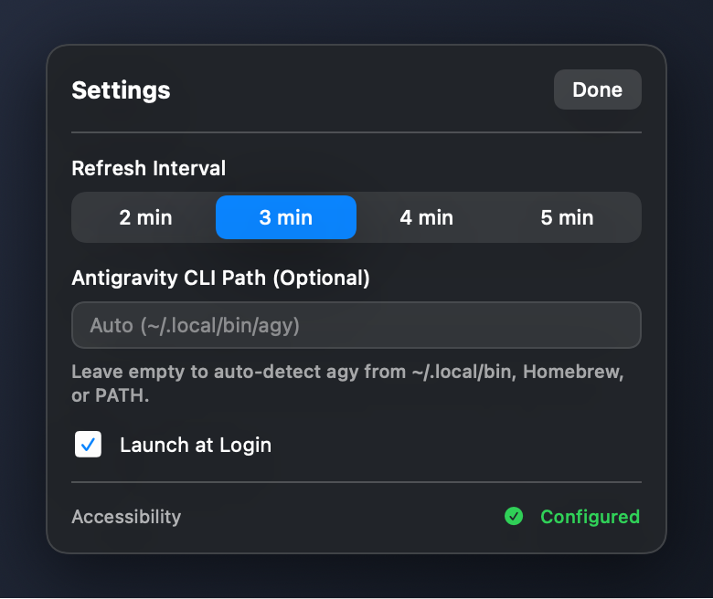

# Antigravity Quota Monitor

A lightweight native macOS menu bar utility written in Swift and SwiftUI that monitors the remaining usage quota for the Google Antigravity AI model currently selected in Xcode.

## Overview

Antigravity Quota Monitor lives unobtrusively in the macOS menu bar (`LSUIElement`), detects which Antigravity AI model is selected in Xcode's built-in coding assistant, queries usage data through the official Antigravity CLI (`agy`), and displays the most restrictive remaining quota percentage at a glance (for example, `H 86%` or `A 99%`).

## Features

- **At-a-Glance Menu Bar Indicator:** Displays the orbital icon (`atom`) alongside the active model's abbreviation and lowest remaining quota percentage (e.g., `H 86%`, `A 99%`) with no Dock icon or standalone window.
- **Detailed Quota Popover:**
  - Active Xcode model label, matched quota group, and color-coded limiting percentage
  - 5-hour and weekly quota progress bars with local-timezone reset timestamps and relative countdowns
  - Secondary view of all other available quota groups (such as `Claude and GPT models` and `Gemini 4 Argon`)
  - Clear status messages for missing Accessibility permission, inactive Xcode sessions, unmatched models, stale snapshots, and CLI errors
  - Last updated timestamp, manual `Refresh` (`Cmd + R`), inline `Settings`, and `Quit` (`Cmd + Q`)
- **Smart Background Refresh:**
  - Configurable periodic quota polling (2, 3, 4, or 5 minutes; default 3 minutes)
  - Lightweight active Xcode model tracking every 15 seconds plus immediate sync when opening the popover
  - Preserves the last valid snapshot with a `Stale` indicator if a temporary CLI refresh fails
  - Coalesces concurrent refresh requests so duplicate `agy` subprocesses never spawn
- **Native Inline Settings:**
  - Refresh interval selector (2–5 min) saved in `UserDefaults`
  - Optional custom `agy` CLI executable path override
  - Optional **Launch at Login** toggle via Apple's `ServiceManagement` (`SMAppService.mainApp`)
  - Live Accessibility permission status indicator

## Screenshots

| Menu Bar Indicator & Quota Popover | Inline Settings |
|---|---|
|  |  |

## System Requirements

- macOS 15.0 (Sequoia) or later
- [Antigravity CLI (`agy`)](https://antigravity.google) installed locally and authenticated
- macOS Accessibility permission granted to **Antigravity Quota Monitor** (required for automatic Xcode model detection)
- Xcode 16+ (only required if building from source)

## Download & Installation

### Option 1: Download Prebuilt App (Recommended)

1. Download the latest `Antigravity-Quota-Monitor-macOS.zip` archive from the [GitHub Releases](https://github.com/GorkemSay/antigravity-quota-monitor/releases/latest) page.
2. Double-click the `.zip` file to extract **Antigravity Quota Monitor.app**.
3. Drag **Antigravity Quota Monitor.app** into your **Applications** (`/Applications`) folder.
4. Launch **Antigravity Quota Monitor** from Applications or Spotlight.
   > **Note on Gatekeeper:** Because the prebuilt archive is not notarized with an Apple Developer ID certificate, macOS may show an unverified developer prompt on first launch. Open **System Settings > Privacy & Security** and click **Open Anyway**, or run `xattr -dr com.apple.quarantine "/Applications/Antigravity Quota Monitor.app"` in Terminal before opening.
5. Click the **atom** icon in the menu bar and select **Grant Accessibility Access** (or enable **Antigravity Quota Monitor** under **System Settings > Privacy & Security > Accessibility**).

### Option 2: Build and Install from Source

1. Clone the repository:
   ```bash
   git clone https://github.com/GorkemSay/antigravity-quota-monitor.git
   cd antigravity-quota-monitor
   ```
2. Build the Release application bundle and install it to `/Applications`:
   ```bash
   xcodebuild build \
     -project "AntigravityQuotaMonitor.xcodeproj" \
     -scheme "AntigravityQuotaMonitor" \
     -configuration Release \
     -destination "platform=macOS" \
     -derivedDataPath build/ReleaseDerivedData

   rm -rf "/Applications/Antigravity Quota Monitor.app"
   cp -R "build/ReleaseDerivedData/Build/Products/Release/Antigravity Quota Monitor.app" /Applications/
   rm -rf build
   open "/Applications/Antigravity Quota Monitor.app"
   ```
   Alternatively, open `AntigravityQuotaMonitor.xcodeproj` in Xcode, select the **AntigravityQuotaMonitor** scheme, and press `Cmd + R`.
3. Grant Accessibility permission to **Antigravity Quota Monitor** when prompted.

## Permissions and Privacy

- **Accessibility Permission:** Used strictly to inspect the selected model label in Xcode's model picker control (`AXMenuButton`). The application does not read source code, conversation history, or unrelated application data.
- **Local Execution (No App Sandbox):** App Sandbox is disabled on the macOS target so the app can query Accessibility attributes from Xcode and run the locally installed `agy` CLI executable via `Process`.
- **Credentials & Logging:** The application does not read, store, or extract OAuth tokens or authentication credentials, makes no direct network calls, and does not log raw CLI output.

## Antigravity CLI Requirements

Antigravity Quota Monitor queries usage data through your locally installed `agy` CLI using:

```bash
agy -p "/usage" --output-format json
```

Because macOS GUI applications launched from Finder do not inherit interactive shell `PATH` variables, the app automatically searches `$HOME/.local/bin/agy`, `/opt/homebrew/bin/agy`, `/usr/local/bin/agy`, `/usr/bin/agy`, and `PATH`. If your `agy` binary lives elsewhere, you can specify a custom path inside **Settings**.

## How It Works

1. **Xcode Model Detection (`XcodeModelDetector`):** Locates running Xcode instances via `NSRunningApplication`, traverses Xcode's window Accessibility hierarchy (`AXUIElement`), and parses the active model selector label into a structured `DetectedModel`.
2. **Quota Retrieval (`AntigravityQuotaProvider`):** Runs `agy -p "/usage" --output-format json` in an isolated subprocess with timeout, handle cleanup, and task coalescing, then parses the JSON response into `QuotaSnapshot`, `QuotaGroup`, and `QuotaBucket` models.
3. **Matching & Presentation (`ModelQuotaMapper`, `QuotaManager`, `PreferencesStore`):** Matches the detected model to its quota group, manages background refresh intervals and stale-data handling, and renders the SwiftUI `MenuBarExtra` interface.

## Supported Model Groups

Based on Antigravity CLI usage output (subject to account configuration and future CLI updates):

| Model | Quota Group | Quota Windows |
|---|---|---|
| Gemini 4 Hydrogen | Gemini Models | Weekly, 5-hour |
| Gemini 3.8 Flash | Gemini Models | Weekly, 5-hour |
| Gemini 4 Argon | Gemini 4 Argon | Weekly |
| Claude Opus 5.5 | Claude and GPT models | Weekly, 5-hour |
| Claude Sonnet 5.5 | Claude and GPT models | Weekly, 5-hour |
| GPT-OSS 120B | Claude and GPT models | Weekly, 5-hour |

## Why This Approach?

### Built on Official Tools

Antigravity Quota Monitor retrieves usage information through Google's Antigravity CLI using its supported command-line interface.

Rather than depending on undocumented internal server endpoints, private authentication mechanisms, or intercepted application traffic, the application uses an existing CLI command to request structured usage information.

This reduces dependency on Antigravity's internal implementation details.

### Native Xcode Model Detection

The application identifies the currently selected Antigravity model using Apple's Accessibility APIs.

It reads the model selection information exposed by Xcode's user interface without modifying Xcode, replacing its built-in agent, or intercepting AI conversations.

This enables automatic model-aware quota monitoring while preserving the user's existing development workflow.

### Privacy by Design

The application operates locally on macOS.

It does not independently collect authentication tokens, read conversation contents, or transmit usage information to application-operated third-party servers.

Quota requests are performed through the installed Antigravity CLI, which may communicate with Google's services as part of its normal operation.

The application requests Accessibility permission only to obtain the model information required for its functionality.

### Reliability Through Separation of Concerns

Model detection, quota retrieval, data parsing, quota mapping, and user interface presentation are structured as independent components.

This architecture makes the application easier to test, maintain, and adapt when Antigravity or Xcode changes.

It also supports explicit error handling, controlled refresh intervals, and safeguards against displaying incorrect or outdated quota information.

### Transparent Limitations

Reliability does not mean guaranteed compatibility with every future version.

The application depends on the continued availability and compatibility of the Antigravity CLI usage command and Xcode's accessibility information.

CLI output formats, model names, quota groups, and Xcode accessibility hierarchies may change.

The application is designed to handle these changes gracefully and clearly communicate when information cannot be retrieved or verified.

### Engineering Principles

Our approach prioritizes:

- Officially provided tools and supported Apple APIs wherever possible.
- Minimal interference with Xcode and Antigravity.
- No direct handling of authentication credentials.
- Modular, testable Swift components.
- Accurate quota reporting with clearly indicated refresh times.
- Explicit error states instead of misleading fallback values.
- Low system resource consumption.
- Long-term maintainability.

> *Note: Antigravity Quota Monitor is an independent utility and is not endorsed by, certified by, or affiliated with Google or Apple.*

## Development & Testing

To run the full unit and UI test suite from Xcode, open `AntigravityQuotaMonitor.xcodeproj` and press `Cmd + U`, or run via terminal:

```bash
xcodebuild test \
  -project "AntigravityQuotaMonitor.xcodeproj" \
  -scheme "AntigravityQuotaMonitor" \
  -destination "platform=macOS"
```

## Known Limitations

- Active model detection requires macOS Accessibility permission to be granted to the running application bundle.
- **Launch at Login** (`SMAppService.mainApp`) requires the app to reside in a standard location such as `/Applications`.
- Depends on the Antigravity CLI `agy -p "/usage" --output-format json` contract and Xcode's Accessibility tree labels remaining compatible across future updates.

## License

This project is licensed under the [MIT License](LICENSE).
